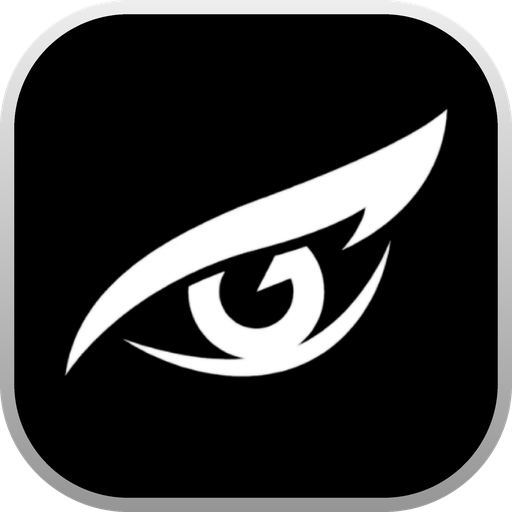

# BoothX

**Le logiciel de photobooth nouvelle génération pour tous vos événements.**  
*Conçu pour les organisateurs, les loueurs de bornes, les photographes et les agences événementielles.*

---

## 📸 Qu'est-ce que BoothX ?

**BoothX** est une solution complète, moderne et intuitive qui transforme n'importe quel ordinateur, tablette ou écran tactile en une véritable **borne photobooth professionnelle**.

Mariages, anniversaires, salons professionnels, lancements de marque, festivals ou soirées d'entreprise : BoothX garantit une animation photo mémorable pour vos invités et une sérénité totale pour les organisateurs.

---

### ✨ Les atouts majeurs pour vos événements

* **🔌 100% Fonctionnel Hors-Ligne (Zéro stress réseau)**  
  Un événement dans un château médiéval, en pleine nature ou dans un sous-sol sans Wi-Fi ? Aucun problème. Prises de vue, mise en page personnalisée et impressions thermiques fonctionnent en totale autonomie, sans nécessiter de connexion internet.

* **📷 Qualité d'Image Studio & Détection Automatique**  
  Branchez votre appareil photo reflex ou hybride **Canon EOS** ou votre webcam haute définition en USB : BoothX le détecte automatiquement, affiche la visée en direct sur l'écran tactile et assure un rendu photo net et éclatant.

* **🖨️ Impressions Instantanées Professionnelles**  
  Compatible avec les imprimantes thermiques à sublimation (DNP, Citizen, Sinfonia, etc.). Vos invités repartent en quelques secondes avec leurs tirages photo sous tous les formats populaires : bandelettes rétro (2×6″), tirages classiques (10×15 cm / 4×6″) ou formats personnalisés.

* **🎨 Éditeur Visuel & Personnalisation Facile**  
  Adaptez chaque détail à l'image de votre événement : ajoutez vos logos, prénoms des mariés, dates, cadres décoratifs, comptes à rebours, filtres photo, GIFs et boomerangs en quelques clics depuis l'éditeur intégré.

* **📱 Galeries en Ligne & Partage par QR Code**  
  À la fin de chaque séance, un QR code dynamique s'affiche à l'écran. Dès que la borne est connectée (pendant ou après la soirée), les invités peuvent télécharger et partager leurs photos en haute définition directement sur leur smartphone.

* **🔒 Mode Kiosque Sécurisé**  
  Verrouillez l'écran en plein écran avec un code secret pour empêcher toute manipulation involontaire du système par les invités lors de vos soirées.

* **🌐 Gestion Centralisée à Distance**  
  Préparez vos événements à l'avance depuis votre bureau avec l'application web [app.boothx.org](https://app.boothx.org) : personnalisez vos modèles, gérez votre parc de bornes et suivez l'activité de vos prestations en temps réel.

---

## 🤝 Notre engagement : L'Open Source pour la communauté

Chez **BoothX**, nous croyons profondément au partage et à l'entraide avec l'ensemble des acteurs de l'événementiel, des constructeurs de bornes indépendantes (makers) et des développeurs passionnés.

En parallèle de notre plateforme logicielle tout-en-un, **nous déployons et maintenons en Open Source plusieurs briques et utilitaires indépendants** directement ici sur cette organisation GitHub :

### 🚀 Prochains outils Open Source déployés pour la communauté :

1. **📷 Applications & Utilitaires Canon EDSDK**  
   Des outils légers et autonomes pour tester, piloter et intégrer le contrôle des boîtiers photo Canon EOS en USB (visée vidéo directe, déclenchement instantané, réglages de prise de vue). Idéal pour tous les passionnés qui créent leur propre cabine photo ou souhaitent un déclencheur fiable et simple.

2. **🖨️ Moniteurs & Diagnostics d'Imprimantes Photo**  
   Des utilitaires dédiés au suivi en temps réel des imprimantes thermiques professionnelles : surveillance des niveaux de papier et du ruban thermique, état des files d'attente d'impression et alertes instantanées en cas d'erreur ou de bac vide, assurant une tranquillité absolue pendant les prestations.

Ces outils open source sont pensés pour être simples d'utilisation, stables et accessibles à tous pour faire avancer l'écosystème du photobooth.

---

## 🌐 Découvrir l'univers BoothX

| Service | Accès | Rôle |
|---|---|---|
| **Site Officiel** | [boothx.org](https://boothx.org) | Présentation de la solution, fonctionnalités et actualités |
| **Téléchargement** | [boothx.org/download](https://boothx.org/download) | Téléchargez gratuitement le logiciel pour Windows, macOS et Linux |
| **Espace Client** | [app.boothx.org](https://app.boothx.org) | Gestion de vos événements, modèles et suivi de vos bornes |
| **Galeries Invités** | [cloud.boothx.org](https://cloud.boothx.org) | Consultation et téléchargement des albums photos en ligne |
| **Boutique de Thèmes** | [shop.boothx.org](https://shop.boothx.org) | Catalogue de templates et cadres graphiques pour vos soirées |
| **Centre d'Aide** | [help.boothx.org](https://help.boothx.org) | Guides de démarrage, matériel compatible et conseils pratiques |

---

### 💬 Besoin d'un renseignement ou d'un accompagnement ?

Notre équipe est à votre écoute pour vous conseiller sur vos événements et vos configurations matérielles.

**Email :** [support@boothx.org](mailto:support@boothx.org) &bull; **Documentation :** [help.boothx.org](https://help.boothx.org)

© BoothX &bull; Tous droits réservés &bull; Développé avec passion pour sublimer vos événements.

