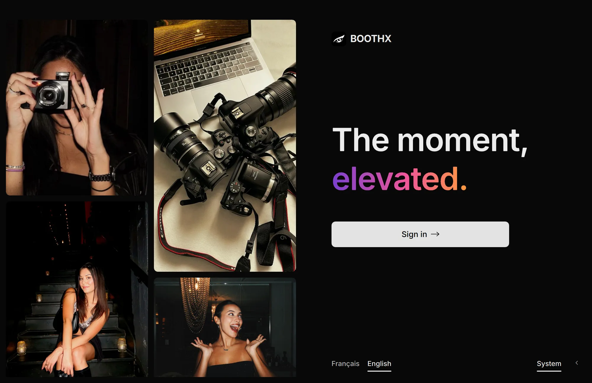

<picture>
  <source media="(prefers-color-scheme: dark)" srcset="https://raw.githubusercontent.com/boothx/.github/main/assets/logo-dark.svg">
  
</picture>

<h3>BoothX</h3>

<a href="https://boothx.org">boothx.org</a> &nbsp;·&nbsp;
<a href="https://app.boothx.org">app.boothx.org</a> &nbsp;·&nbsp;
<a href="https://shop.boothx.org">shop.boothx.org</a> &nbsp;·&nbsp;
<a href="https://support.boothx.org">support.boothx.org</a>

  

<b>Français</b>

### Le logiciel de photobooth hors connexion pour vos événements

Installez BoothX sur un ordinateur ou une tablette, branchez un boîtier et une imprimante : la borne est prête. Gratuit avec un compte BoothX.

<table>
<tr>
<td width="50%"><b>Hors-ligne</b> Tout tourne sur l'appareil de la borne. Le réseau tombe, les tirages sortent.</td>
<td width="50%"><b>Détection automatique</b> Appareils et imprimantes reconnus au branchement, reconnectés s'ils décrochent.</td>
</tr>
<tr>
<td><b>Éditeur</b> Calques, textes, formes, dessin, images et vidéos, compte à rebours, QR code.</td>
<td><b>Un design par événement</b> Chaque événement garde son template, ses écrans et son fond de verrouillage.</td>
</tr>
<tr>
<td><b>Borne verrouillée</b> Sortie protégée par mot de passe, raccourcis du système bloqués.</td>
<td><b>Galerie par QR code</b> Le QR code s'affiche avec le montage : les invités retrouvent la galerie de l'événement.</td>
</tr>
</table>

### Matériel

| 26 | 19 | 10 |
|:-:|:-:|:-:|
| boîtiers Canon EOS, par USB | imprimantes, 7 marques | formats d'impression, du 2×6″ à l'A4 |

DNP, Mitsubishi, Citizen, HiTi, Kodak, Sinfonia et Canon Selphy, ainsi que les webcams USB. [Liste complète](https://boothx.org/fr-fr/compatibility)

### Forfaits

Le logiciel reste gratuit. Plus de bornes, d'événements et de stockage, au mois ou à l'année.

| | Community | Pro | Ultra |
|---|:-:|:-:|:-:|
| Appareils | 1 | 4 | 25 |
| Événements | 20 | 100 | 500 |
| Espace cloud | 100 Mo | 10 Go | 100 Go |
| Modèles | Part gratuite de chaque thème | 4 thèmes par mois | Toute la banque et la boutique |
| En plus | Impression illimitée, hors-ligne | Sauvegarde auto, galerie en ligne, musique | Affichage HDMI, télécommande depuis le téléphone, IA (bientôt) |

[Comparer les forfaits](https://shop.boothx.org/fr-fr/plans)

### Liens

- [Télécharger](https://boothx.org/fr-fr/download) : Windows, macOS et Linux ; iPad et Android bientôt.
- [App](https://app.boothx.org) : vos bornes et vos événements en direct, depuis un ordinateur, une tablette ou un téléphone.
- [Galeries](https://cloud.boothx.org) : les photos des invités, récupérées par QR code.
- [Boutique](https://shop.boothx.org/fr-fr) : forfaits, templates et packs.
- [Assistance](https://support.boothx.org/fr-fr) : le guide complet, de l'installation au soir de l'événement.
- Contact : [support@boothx.org](mailto:support@boothx.org)

Des utilitaires open source seront publiés ici : pilotage des boîtiers Canon EOS (EDSDK) et suivi des imprimantes photo.

<b>English</b>

### The offline photo booth software for your events

Install BoothX on a computer or tablet, plug in a camera and a printer: the booth is ready. Free with a BoothX account.

<table>
<tr>
<td width="50%"><b>Offline</b> Everything runs on the booth's device. The network drops, the prints keep coming.</td>
<td width="50%"><b>Automatic detection</b> Cameras and printers recognised when plugged in, reconnected if they drop.</td>
</tr>
<tr>
<td><b>Editor</b> Layers, text, shapes, drawing, images and videos, countdown, QR code.</td>
<td><b>A design per event</b> Each event keeps its own template, screens and lock background.</td>
</tr>
<tr>
<td><b>Locked booth</b> Exit protected by a password, system shortcuts blocked.</td>
<td><b>QR code gallery</b> The QR code shows with the layout: guests find the event's gallery.</td>
</tr>
</table>

### Hardware

| 26 | 19 | 10 |
|:-:|:-:|:-:|
| Canon EOS bodies, over USB | printers, 7 brands | print formats, from 2×6″ to A4 |

DNP, Mitsubishi, Citizen, HiTi, Kodak, Sinfonia and Canon Selphy, as well as USB webcams. [Full list](https://boothx.org/en-us/compatibility)

### Plans

The software stays free. More booths, events and storage, monthly or yearly.

| | Community | Pro | Ultra |
|---|:-:|:-:|:-:|
| Devices | 1 | 4 | 25 |
| Events | 20 | 100 | 500 |
| Cloud storage | 100 MB | 10 GB | 100 GB |
| Templates | Free part of each theme | 4 themes a month | The whole library and shop |
| Also | Unlimited printing, offline | Automatic backup, online gallery, music | HDMI display, remote control from your phone, AI (soon) |

[Compare plans](https://shop.boothx.org/en-us/plans)

### Links

- [Download](https://boothx.org/en-us/download): Windows, macOS and Linux; iPad and Android soon.
- [App](https://app.boothx.org): your booths and events live, from a computer, tablet or phone.
- [Galleries](https://cloud.boothx.org): the guests' photos, picked up by QR code.
- [Shop](https://shop.boothx.org/en-us): plans, templates and packs.
- [Help](https://support.boothx.org/en-us): the complete guide, from installation to the night of the event.
- Contact: [support@boothx.org](mailto:support@boothx.org)

Open source utilities will be published here: Canon EOS camera control (EDSDK) and photo printer monitoring.

<b>Español</b>

### El software de fotomatón sin conexión para tus eventos

Instala BoothX en un ordenador o una tableta, conecta una cámara y una impresora: el fotomatón está listo. Gratis con una cuenta BoothX.

<table>
<tr>
<td width="50%"><b>Sin conexión</b> Todo funciona en el equipo del fotomatón. Si cae la red, las copias siguen saliendo.</td>
<td width="50%"><b>Detección automática</b> Cámaras e impresoras reconocidas al conectarlas y reconectadas si se desconectan.</td>
</tr>
<tr>
<td><b>Editor</b> Capas, textos, formas, dibujo, imágenes y vídeos, cuenta atrás, código QR.</td>
<td><b>Un diseño por evento</b> Cada evento guarda su plantilla, sus pantallas y su fondo de bloqueo.</td>
</tr>
<tr>
<td><b>Fotomatón bloqueado</b> Salida protegida con contraseña y atajos del sistema bloqueados.</td>
<td><b>Galería por código QR</b> El código QR aparece con el montaje: los invitados encuentran la galería del evento.</td>
</tr>
</table>

### Equipos

| 26 | 19 | 10 |
|:-:|:-:|:-:|
| cuerpos Canon EOS, por USB | impresoras, 7 marcas | formatos de impresión, de 2×6″ a A4 |

DNP, Mitsubishi, Citizen, HiTi, Kodak, Sinfonia y Canon Selphy, además de las webcams USB. [Lista completa](https://boothx.org/es-es/compatibility)

### Planes

El software sigue siendo gratuito. Más fotomatones, eventos y almacenamiento, al mes o al año.

| | Community | Pro | Ultra |
|---|:-:|:-:|:-:|
| Dispositivos | 1 | 4 | 25 |
| Eventos | 20 | 100 | 500 |
| Espacio en la nube | 100 MB | 10 GB | 100 GB |
| Plantillas | Parte gratuita de cada tema | 4 temas al mes | Todo el banco y la tienda |
| Además | Impresión ilimitada, sin conexión | Copia automática, galería en línea, música | Pantalla HDMI, control remoto desde el móvil, IA (pronto) |

[Comparar planes](https://shop.boothx.org/es-es/plans)

### Enlaces

- [Descargar](https://boothx.org/es-es/download): Windows, macOS y Linux; iPad y Android muy pronto.
- [App](https://app.boothx.org): tus fotomatones y eventos en directo, desde un ordenador, una tableta o un móvil.
- [Galerías](https://cloud.boothx.org): las fotos de los invitados, por código QR.
- [Tienda](https://shop.boothx.org/es-es): planes, plantillas y packs.
- [Ayuda](https://support.boothx.org/es-es): la guía completa, de la instalación a la noche del evento.
- Contacto: [support@boothx.org](mailto:support@boothx.org)

Aquí se publicarán utilidades de código abierto: control de cámaras Canon EOS (EDSDK) y supervisión de impresoras fotográficas.

