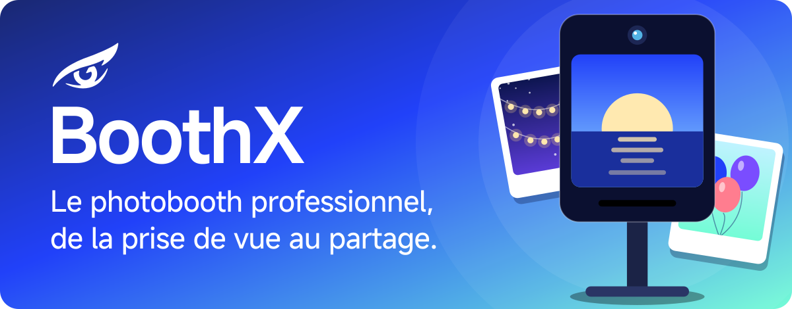
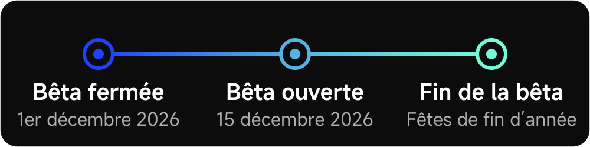
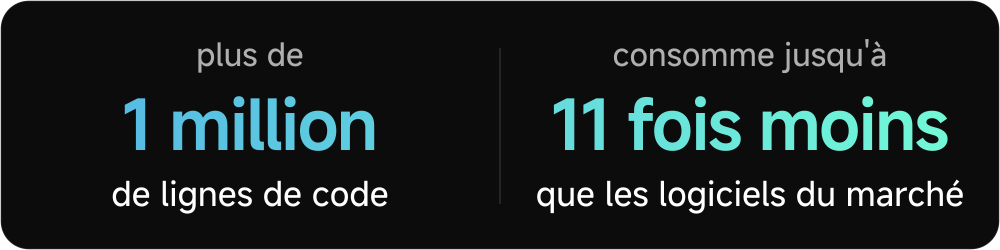
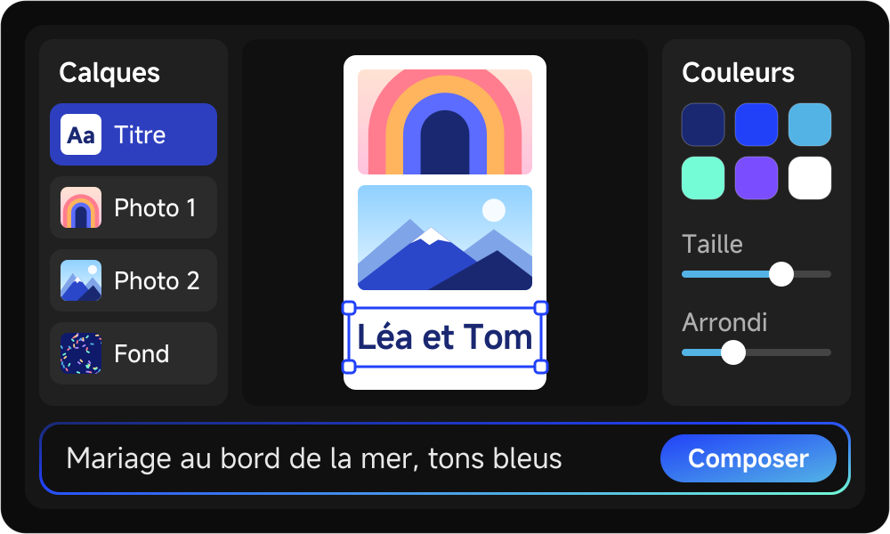
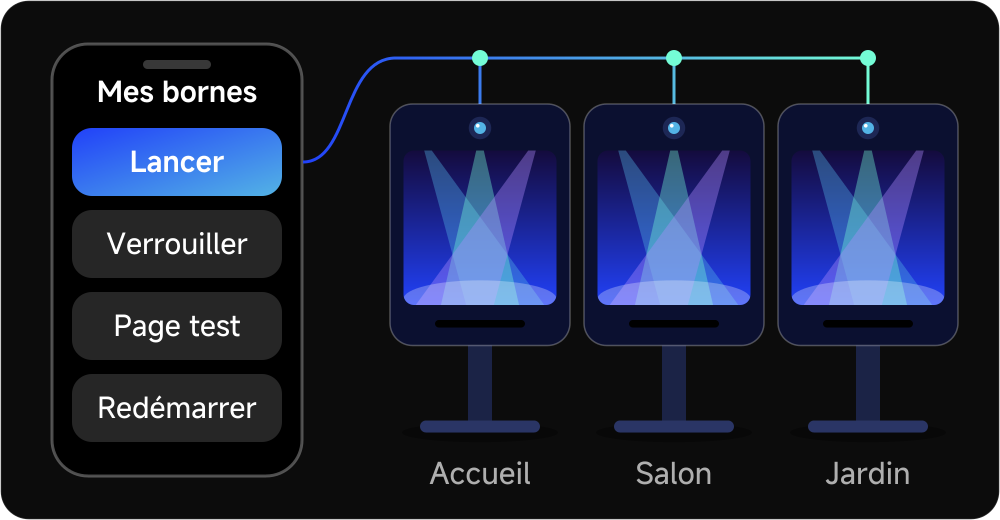
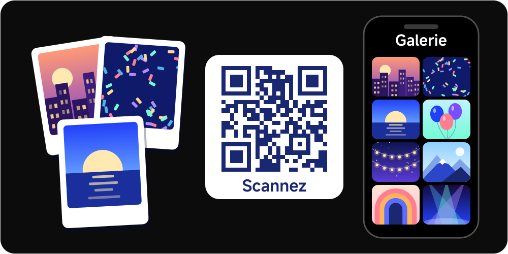
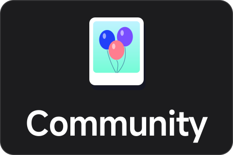
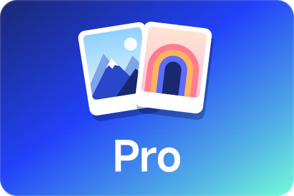
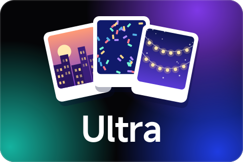

 

 

## Extrêmement rapide, partout

Compilé en code machine et dessiné par la carte graphique, sans navigateur caché. La soirée continue même sans Internet.

## Un éditeur qui crée avec vous

Superposez, écrivez, dessinez. Ou décrivez l’ambiance : l’intelligence artificielle propose une création prête à retoucher.

## Toutes vos bornes dans une télécommande

Préparez l’événement une seule fois : chaque borne le reçoit avec ses écrans et ses réglages.

## La galerie dans la poche des invités

Photos, GIF et boomerangs sont sauvegardés dans le cloud. Si le réseau coupe, l’envoi reprend dès son retour.

## Prêt pour votre matériel

Reflex et hybrides Canon EOS en USB, webcams, clés d’acquisition, 19 imprimantes photo de 7 marques, lampes WLED et flash : voir la [liste complète](https://www.boothx.org/compatibility). Spotify, Deezer et YouTube Music pour l’ambiance, une boutique de modèles et des extensions pour le reste.

## Gratuit pour tous, deux abonnements à la consommation

<table>
<tr>
<td width="36%"></td>
<td>Le logiciel complet, sans filigrane. Événements et impressions sans limite, usage commercial compris.</td>
</tr>
<tr>
<td></td>
<td>Appareils illimités et commande à distance. Votre logo et vos couleurs à l’écran, des packs au choix chaque mois, davantage d’IA et d’espace cloud.</td>
</tr>
<tr>
<td></td>
<td>Toute la boutique incluse, nouveautés en avant-première, quotas les plus élevés. Support prioritaire le jour J.</td>
</tr>
</table>

## Bientôt

360 Booth, Mirror Booth, Photomaton, Kiosque et Borne de jeu. Filtres visage en direct, détourage sans fond vert, partage par réseau local.

 

[Site](https://www.boothx.org) · [Aide](https://support.boothx.org) · [Contact](mailto:support@boothx.org)

© BoothX. Tous droits réservés.

