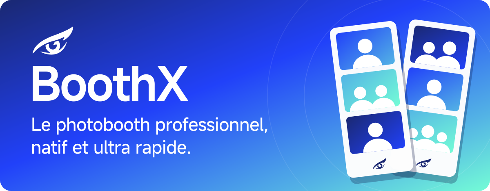
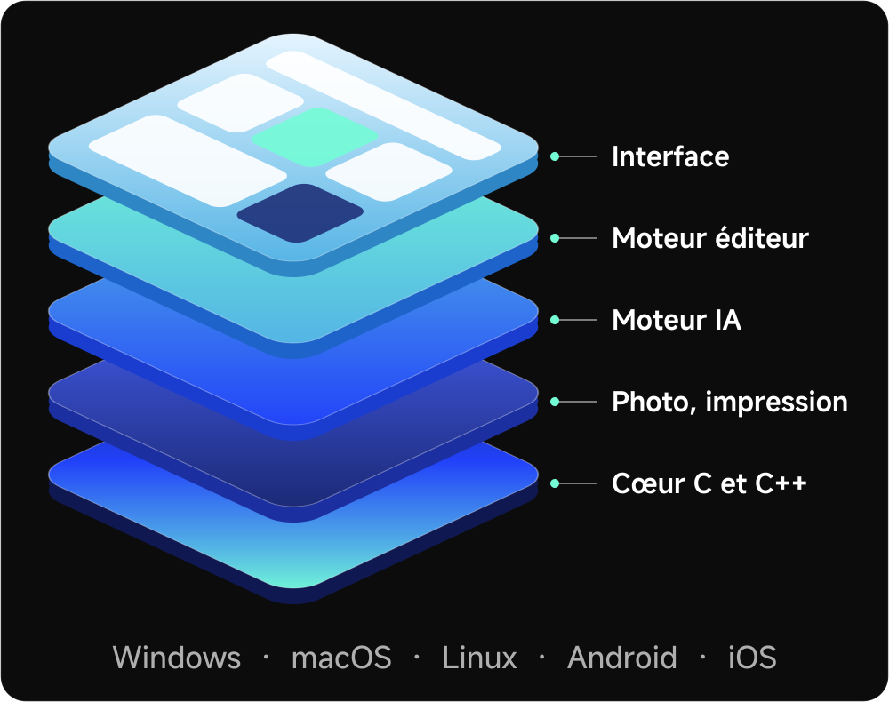
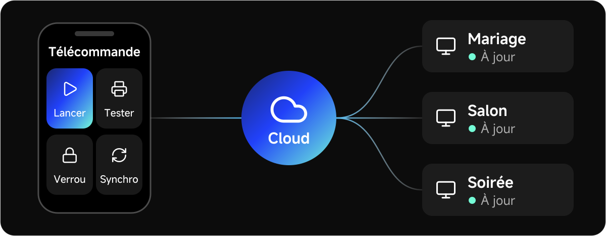

  

Photographiez, imprimez et partagez vos événements, même sans connexion Internet. 
Une application native écrite en C++, pensée pour tenir toute la soirée.

 

## Ultra rapide, parce que native

BoothX n'est pas une page web dans une fenêtre. L'application est compilée en code machine, jusqu'à son interface, et affichée par la carte graphique. La borne répond au doigt, d'un événement à l'autre.

- **Un seul cœur en C et C++** : la même base de code pour toutes les plateformes, sans navigateur embarqué.
- **Moteur d'éditeur** : calques, textes, dessin et aimantation calculés en natif, sur la borne.
- **Moteur d'IA** : suivi du visage et détourage calculés sur la machine, sans envoyer la photo sur un serveur (bientôt dans la version publique).
- **Hors ligne d'abord** : la prise de vue, l'éditeur et l'impression ne dépendent jamais du réseau.

 

## La télécommande et vos bornes, toujours au même point

- **Depuis votre téléphone** : lancez ou arrêtez un événement, imprimez une page test, verrouillez la borne, relancez le logiciel.
- **Le résultat revient aussitôt** : la borne répond à chaque commande, et son état remonte au panneau.
- **Un événement saisi une fois** : il arrive avec son design sur toutes les bornes du compte.
- **Une coupure ne bloque rien** : la borne continue, et tout se rattrape au retour du réseau.

 

## Tout ce qu'il faut pour un événement

<table>
<tr>
<td width="50%" valign="top">

<h3>Appareils photo</h3>
Reflex et hybrides Canon EOS en USB, webcams et clés d'acquisition, avec la vue en direct.
</td>
<td width="50%" valign="top">

<h3>Impression</h3>
Imprimantes photo de sept marques, une file d'attente par événement, sans internet.
</td>
</tr>
<tr>
<td valign="top">

<h3>Éditeur</h3>
Templates photo et écrans d'accueil dessinés sur la borne ou dans l'app web, puis imprimés aussitôt.
</td>
<td valign="top">

<h3>Intelligence artificielle</h3>
Décrivez la soirée : un template arrive dans l'éditeur, prêt à retoucher.
</td>
</tr>
<tr>
<td valign="top">

<h3>Télécommande</h3>
Pilotez vos bornes à distance, depuis le panneau web ou le téléphone, dès le forfait Pro.
</td>
<td valign="top">

<h3>Synchronisation</h3>
Événements, designs et réglages suivent votre compte, d'une borne à l'autre.
</td>
</tr>
<tr>
<td valign="top">

<h3>Cloud et galeries</h3>
Photos, GIF et boomerangs sauvegardés, galerie ouverte par QR code sur le téléphone des invités.
</td>
<td valign="top">

<h3>Boutique</h3>
Packs et templates à installer en quelques instants.
</td>
</tr>
<tr>
<td valign="top">

<h3>Musique</h3>
L'ambiance sonore de la soirée, reliée depuis la borne.
</td>
<td valign="top">

<h3>Lumière</h3>
Éclairage et flash réglés dans l'application.
</td>
</tr>
<tr>
<td valign="top">

<h3>Extensions</h3>
Activez seulement les modes et les fonctions dont vous avez besoin.
</td>
<td valign="top">

<h3>Hors ligne</h3>
Capture, éditeur et impression restent disponibles sans réseau.
</td>
</tr>
</table>

 

## Multiplateforme

| Windows | macOS | Linux | Android et iOS |
|:---:|:---:|:---:|:---:|
| Borne complète | Borne complète | Borne complète | App de pilotage |

BoothX arrive bientôt : inscrivez-vous sur [boothx.org](https://www.boothx.org) pour être prévenu du lancement. Le forfait Community sera gratuit, sans limite d'événements et sans filigrane.

 

## Feuille de route

- **Modes d'événement** : 360 Booth, Mirror Booth, Photomaton, Kiosque et Borne de jeu.
- **IA sur la borne** : filtres visage en direct et détourage sans fond vert, en cours d'intégration.
- **Sur place, sans internet** : télécommande et partage par le réseau local de la borne.

 

[Site](https://www.boothx.org) · [Fonctionnalités](https://www.boothx.org/features/software) · [Compatibilité](https://www.boothx.org/compatibility) · [Aide](https://support.boothx.org) · [Contact](mailto:support@boothx.org)

© BoothX. Tous droits réservés.

